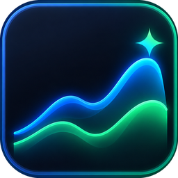
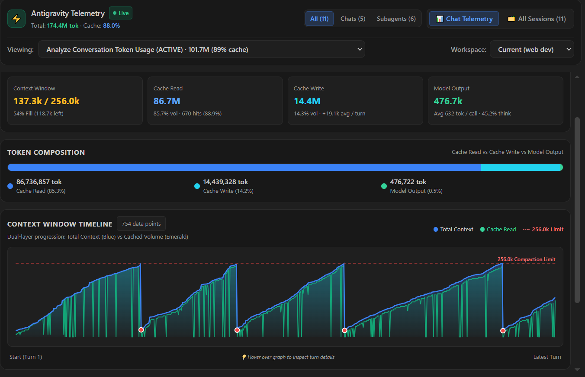

<p align="center">
  
</p>

<h1 align="center">Antigravity Telemetry</h1>

<p align="center">
  <strong>Real-time LLM telemetry monitor, visual observability dashboard, and storage hygiene for Google Antigravity.</strong><br>
  Built for <strong>VS Code</strong>, <strong>VSCodium</strong>, <strong>Cursor</strong>, <strong>Windsurf</strong>, and the standalone <strong>Antigravity IDE</strong>.
</p>

<p align="center">
  <a href="vscode:extension/HarshMann.antigravity-telemetry"></a>
  <a href="vscode:extension/HarshMann.antigravity-telemetry"></a>
  <a href="https://open-vsx.org/extension/HarshMann/antigravity-telemetry"></a>
  <a href="https://open-vsx.org/extension/HarshMann/antigravity-telemetry"></a>
  <a href="https://github.com/harshmann10/Antigravity-Telemetry/releases/latest"></a>
  <a href="https://github.com/harshmann10/Antigravity-Telemetry"></a>
  <a href="https://github.com/harshmann10/Antigravity-Telemetry/blob/main/package.json"></a>
  <a href="https://opensource.org/licenses/MIT"></a>
</p>

<p align="center">
  <a href="#-why-antigravity-telemetry">Why Telemetry?</a> &nbsp;•&nbsp;
  <a href="#-features">Features</a> &nbsp;•&nbsp;
  <a href="#%EF%B8%8F-command-palette-reference">Commands</a> &nbsp;•&nbsp;
  <a href="#%EF%B8%8F-settings">Settings</a> &nbsp;•&nbsp;
  <a href="#-installation">Installation</a> &nbsp;•&nbsp;
  <a href="#-compatibility--prerequisites">Compatibility</a> &nbsp;•&nbsp;
  <a href="#-support-the-project">Support</a>
</p>

<p align="center">
  
</p>

---

## ⚡ Why Antigravity Telemetry?

| The Problem | How Antigravity Telemetry Solves It |
| :--- | :--- |
| **Context Window Blindness**<br>Antigravity doesn't natively show how close you are to the working ceiling until compaction triggers and abruptly cuts session history. | **Live Status Bar & Ceiling Calibration**<br>Calibrated to Antigravity's **256,000 token ceiling** with live fill %, proactive compaction warnings, and dual-layer interactive SVG timelines. |
| **"Ghost Chats" & Disk Bloat**<br>Antigravity's built-in chat deletion often only removes the catalog record, leaving 20 MB–80 MB+ of SQLite DBs, transcripts, and media files orphaned on disk. | **Complete Zero-Residue Deletion**<br>Wipes all 7 storage layers completely with **Windows Recycle Bin protection by default** for safe, recoverable cleanup. |
| **Black-Box Subagents**<br>Autonomous background workers (`browser`, `DeepInvestigator`) clutter chat lists with cryptic *"Untitled Conversation"* entries. | **Specialized Role Decoding & Hierarchy**<br>Decodes protobuf task records into genuine role titles (e.g. `Icon Designer`, `Research Assistant`) with nested drawers and parent-child cost rollups. |
| **Multi-Environment Fragmentation**<br>Users work across standalone Antigravity IDE, VS Code extension, and terminal CLI environments with separate data stores. | **Unified Multi-Root Observability**<br>Automatically loads the active editor's data (`antigravity-ide` vs `antigravity`) and surfaces matching or active Antigravity CLI sessions (`antigravity-cli`), with merged all-source views. |
| **Zero Overhead & Total Privacy**<br>Most observability tools query third-party APIs or consume model tokens. | **100% Offline & Free**<br>Pure local SQLite and protobuf wire decoding. Zero external npm dependencies, zero network requests, zero API tokens consumed. |

---

## ✨ Features

### 1. 📊 Live Context & Token Intelligence

- **Status Bar Item**: Real-time display showing active chat title, context tokens, fill %, and prompt cache hit rate:
  ```text
  [Chat Title] | 182k (71%) · 98.4% cache
  ```
- **Compaction Ceiling Calibration**: Measured against Antigravity's true **256,000 token working ceiling** (so 182k displays 71% full, giving an honest indicator of working memory before compaction occurs).
- **Proactive Compaction Notices**: Automatically detects context reduction events and alerts you:
  ```text
  [Chat Title] | Compacted (-71k) · 98.4%
  ```
- **Markdown Hover Card**: Hovering over the status bar item reveals a rich breakdown with a 12-segment ASCII window meter (`[████████░░░░]`), cache volume breakdown, and reasoning tokens.

---

### 2. 📈 Visual Observability Dashboard (Editor Tab)

Opens side-by-side with your code (`Ctrl + Shift + P` $\rightarrow$ `Antigravity: Open Full Visual Dashboard`) and updates in real-time:

- **Split-Window Optimized**: Pinned header and top KPI cards sit comfortably without scrolling even in narrow side-by-side editor splits.
- **Top 4 KPIs**:
  - **Context Window**: Current tokens, fill %, and remaining headroom.
  - **Cache Read**: Total cached prompt tokens and cache hit percentage.
  - **Uncached Input**: Fresh prompt additions per turn.
  - **Model Output**: Total generated tokens and thinking ratio.
- **Dual-Layer SVG Context Timeline**:
  - **Blue Curve**: Total context progression across every turn read from Antigravity's trajectory counter.
  - **Emerald Area**: Cached prompt volume per turn, clamped cleanly to the context curve.
  - **Red Guideline**: Visual ceiling line with marker dots on genuine compaction turns.
  - **Intelligent Compaction Qualification**: Automatically filters out transient single-turn planner V-dips (intermediate steps where tool outputs are temporarily pruned before resuming full context), ensuring only authentic session compactions increment counters.
  - **Interactive Crosshairs & Hover Tooltip**: Track precise turn numbers, context %, cached volume, fresh additions, and generation output.
  - **Anti-Flicker Memoization**: Skips redundant SVG re-renders during background polling so chart tooltips never jump or dismiss while hovering.
- **Session Intelligence Grid**:
  - **⚡ Last Turn Activity**: Delta fresh tokens added, output, and compaction state.
  - **📊 Per-Turn Averages**: Average context, output, thinking tokens, and cache volume.
  - **🛡️ Cache Performance**: Total hits vs. calls, cold start misses, and compaction count.
  - **🏔️ Session Peaks**: Peak context reached (% of ceiling), peak generation, and peak reasoning tokens.
- **🔄 On-Demand Manual Refresh**: Click the header refresh button anytime for immediate synchronization with tactile press feedback and live status confirmation.

---

### 3. 🤖 Autonomous Subagent & Background Worker Organization

Antigravity spawns background workers (`browser`, `firefox_browser`, `DeepInvestigator…`) that write their own conversation records. Antigravity Telemetry neatly organizes them:

- **Specialized Role Decoding**: Decodes internal protobuf task records (`Tag 17 → Tag 8 → Tag 2`) across both JSON and delimiter catalog fallback paths to extract genuine subagent task roles (e.g., `Icon Designer`, `Research Assistant`), eliminating generic "Untitled Conversation" labels.
- **Nested Collapsible Drawers**: Sessions with subagents display expandable drawers (`▾ 🤖 3 subagents · 165.0k tok · 0.6 MB`) that tuck away clutter while keeping child telemetry accessible in one click.
- **Node-Level Tree Collapse**: Beyond the global session drawer, any subagent that spawns child workers features its own individual collapse/expand chevrons and pill buttons (`▾ X subagents`) in both the All Sessions list and the Detail view card, allowing fine-grained control over deep delegation trees.
- **Rolled-Up Cost Accounting**: Selecting a parent conversation provides a *Subagents & Background Workers* card with exact breakdown (`Parent + Subagents = Total`).
- **Collapsible Breakdown Card**: Interactive toggle (`▼ Collapse` / `▶ Expand`) with smooth scrolling for sessions with multiple background workers.
- **Breadcrumb Navigation**: Subagents feature one-click breadcrumb links back to their parent session.
- **Human Chats Drive the Footer**: Background workers finishing later cannot accidentally hijack your status bar active chat.

---

### 4. 🗑️ Zero-Residue Storage Hygiene & Ghost Chat Deletion

Antigravity's native delete action often removes only the catalog record while leaving dozens of megabytes of orphaned SQLite databases and `brain/` transcripts on disk.

Antigravity Telemetry provides true, verified cleanup:

- **Wipes All 7 Storage Layers**:
  - `conversations/<id>.db`, `.db-wal`, `.db-shm`
  - `brain/<id>/` folder (transcripts, media, scratch files)
  - `annotations/<id>.pbtxt`
  - `browser_recordings/<id>/`
  - `implicit/<id>.pb`
  - Catalog row in `conversation_summaries.db`
- **Recycle Bin by Default**: Files are moved to the Windows Recycle Bin instead of being permanently shredded, making accidental deletions recoverable. Set `antigravity.deleteToRecycleBin: false` for permanent deletion.
- **Honest Post-Delete Verification**: Every file path is verified gone *after* deletion. If a file is locked by a running process, the catalog entry is preserved to avoid creating half-deleted ghost chats, and locked paths are surfaced in logs.
- **In-Dashboard & QuickPick Deletion**: Delete chats with a detailed confirmation modal displaying the exact files and megabytes being freed.

---

### 5. 🛸 Multi-Root Support: Antigravity IDE, Extension & CLI *(Preview / In Progress)*

- **Host-Aware Discovery**: Automatically detects whether you are working in the standalone **Antigravity IDE** (`~/.gemini/antigravity-ide`) or **VS Code / VSCodium** (`~/.gemini/antigravity`), loading the corresponding sessions with zero configuration.
- **Antigravity CLI Support (In Progress)**: Discovers terminal `agy` CLI sessions residing in `~/.gemini/antigravity-cli`. In `auto` mode, active or matching CLI sessions are integrated without hijacking host editor chats when idle.
- **Unified All Mode**: Set `antigravity.dataSource: "all"` anytime to view sessions from all environments merged side-by-side with clear `IDE`, `Ext`, and `CLI` visual badges and timestamp deduplication.
- **Antigravity IDE Catalog Integration (`state.vscdb`)**: Decodes session summaries directly from Antigravity IDE's state database (`%APPDATA%\Antigravity IDE\User\globalStorage\state.vscdb`), resolving titles, step counts, timestamps, and workspace mappings.
- **In-DB Self-Description Fallback**: In-flight or newly opened sessions in Antigravity IDE are automatically self-described using internal `trajectory_metadata_blob` and `steps` tables, ensuring live sessions are recognized immediately and never falsely marked as ghost chats.
- **Workspace Scoping**: Automatically resolves each conversation's `workspace_uris` to real paths and scopes the status bar, history picker, and dashboard to your currently active project folder (supports case-insensitive path prefix matching).
- **Instant Startup & Caching**: Serializes analysis state to isolated local extension storage (`globalStorageUri`) on reload. Warm restart reads take **~50 ms** (~98% faster than cold scanning), and periodic heartbeats run in **~6 ms** with **0 bytes of network traffic** over Remote SSH.

---

## ⌨️ Command Palette Reference

All features can be triggered from the Command Palette (`Ctrl + Shift + P` / `Cmd + Shift + P`):

| Command | Title | Description |
| :--- | :--- | :--- |
| `antigravity.openDashboard` | **Antigravity: Open Full Visual Dashboard** | Opens the live side-by-side visual observability editor tab |
| `antigravity.showMenu` | **Antigravity: Telemetry Menu** | Opens the two-level QuickPick menu from the status bar |
| `antigravity.refresh` | **Antigravity: Refresh Telemetry** | Forces an immediate on-demand re-scan of local databases |
| `antigravity.deleteConversation` | **Antigravity: Delete a Conversation** | Prompts a safe session picker to delete files and free disk space |
| `antigravity.showLogs` | **Antigravity: Show Logs** | Opens the Antigravity Telemetry OutputChannel |

---

## ⚙️ Settings

Customize behavior in VS Code Settings (`Ctrl + ,` $\rightarrow$ search `Antigravity`):

| Setting | Default | Description |
| :--- | :--- | :--- |
| `antigravity.dataSource` | `"auto"` | Data source: `"auto"` (active editor + matching/running CLI), `"ide"`, `"extension"`, `"cli"`, or `"all"`. |
| `antigravity.enableCache` | `true` | Enable persistent disk caching for instant startup (< 50ms). When disabled, telemetry is freshly re-scanned from SQLite. |
| `antigravity.deleteToRecycleBin` | `true` | Move conversation files to the Windows Recycle Bin instead of deleting them permanently. |
| `antigravity.workspaceFilter` | `"current"` | Filter telemetry to the active workspace project (`"current"`) or show all (`"all"`). |
| `antigravity.sqlitePath` | `""` | Custom path to `sqlite3` CLI executable. When empty, searches standard paths and PATH automatically. |

---

## 📥 Installation

### Option 1: Visual Studio Code & VS Code Insiders (Recommended)

Click below to open and install directly inside your editor:

<p>
  <a href="vscode:extension/HarshMann.antigravity-telemetry"></a>
  <a href="vscode-insiders:extension/HarshMann.antigravity-telemetry"></a>
</p>

*(Or view the web listing on the [VS Code Marketplace](https://marketplace.visualstudio.com/items?itemName=HarshMann.antigravity-telemetry))*

#### Manual Search & Install:
1. Open VS Code or VS Code Insiders $\rightarrow$ Extensions (`Ctrl + Shift + X` / `Cmd + Shift + X`).
2. Search for **`Antigravity Telemetry`** (Publisher: **HarshMann**).
3. Click **Install**.

*Or install via terminal:*
```bash
# VS Code Stable
code --install-extension HarshMann.antigravity-telemetry

# VS Code Insiders
code-insiders --install-extension HarshMann.antigravity-telemetry
```

---

### Option 2: Open VSX Registry (VSCodium, Gitpod, Code-OSS)
Install directly from the **[Open VSX Registry](https://open-vsx.org/extension/HarshMann/antigravity-telemetry)**:
1. Open your editor $\rightarrow$ Extensions (`Ctrl + Shift + X`).
2. Search for **`Antigravity Telemetry`** (Publisher: **HarshMann**).
3. Click **Install**.

*Or install via terminal:*
```bash
codium --install-extension HarshMann.antigravity-telemetry
# or via ovsx CLI
npx ovsx get HarshMann.antigravity-telemetry
```

---

### Option 3: Standalone VSIX Package
1. Download the latest `.vsix` from [GitHub Releases](https://github.com/harshmann10/Antigravity-Telemetry/releases/latest).
2. Open VS Code $\rightarrow$ Extensions (`Ctrl + Shift + X`) $\rightarrow$ click **`...`** (Views and More Actions) at top-right $\rightarrow$ **Install from VSIX...**.
3. Select the downloaded `.vsix` package.

*Or install via terminal:*
```bash
code --install-extension antigravity-telemetry-*.vsix
```

---

## 📋 Compatibility & Prerequisites

- **Supported Environments**: VS Code, VS Code Insiders, VSCodium, Cursor, Windsurf, Gitpod, and standalone Antigravity IDE.
- **Operating Systems**: Windows, macOS, and Linux.
- **Prerequisites**:
  - Google Antigravity installed (telemetry is auto-detected from `~/.gemini/antigravity-ide` and/or `~/.gemini/antigravity`).
  - `sqlite3` CLI executable (pre-installed on macOS/Linux; auto-detected on Windows or configurable via `antigravity.sqlitePath`).

---

## 🛠️ Development & Contributing

### Running Verification Tests
A zero-dependency test suite verifies protobuf decoding, math calculations, incremental cache parity, and changelog parsing:
```bash
node scripts/self-check.js
```
*Runs **254 assertions across 14 sections** in < 2 seconds without external test frameworks.*

### Rebuilding Dashboard Stylesheet
`media/dashboard.css` is pre-compiled and committed to guarantee zero runtime dependencies. If you modify Tailwind classes in `dashboardHtml.js`, re-build it:
```bash
npm run build:css
```

### Packaging .vsix
Generate a production-ready `.vsix` package:
```bash
npm run package
```

---

## 💖 Support the Project

If you find Antigravity Telemetry helpful, consider supporting its development:

* ⭐ **Star the Repository**: Leave a star on [GitHub](https://github.com/harshmann10/Antigravity-Telemetry) — it helps others discover the project!
* ☕ **GitHub Sponsors**: Support ongoing maintenance and new features via [GitHub Sponsors](https://github.com/sponsors/harshmann10).
* 💡 **Report Issues & Ideas**: Spotted a bug or have a suggestion? Open an issue on [GitHub Issues](https://github.com/harshmann10/Antigravity-Telemetry/issues).

<p align="left">
  <a href="https://github.com/harshmann10/Antigravity-Telemetry"></a>
  &nbsp;&nbsp;
  <a href="https://github.com/sponsors/harshmann10"></a>
</p>

---

## 📄 License

This project is licensed under the [MIT License](LICENSE).
